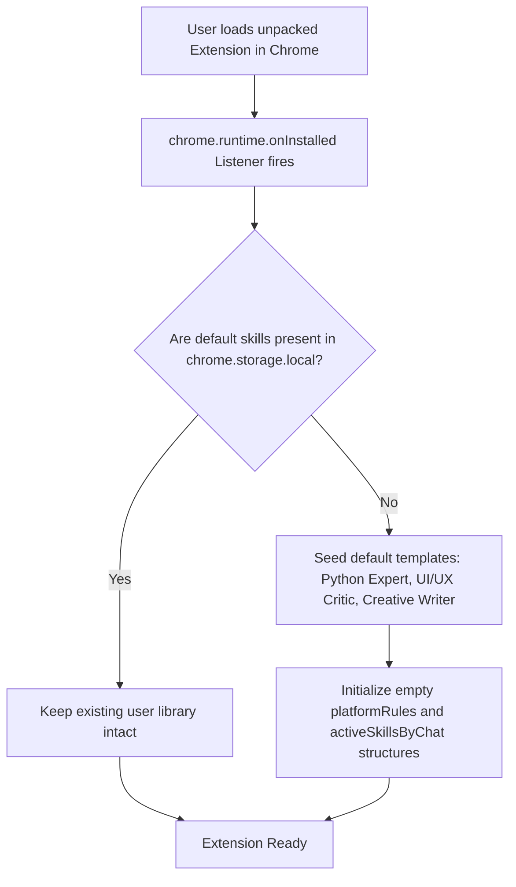
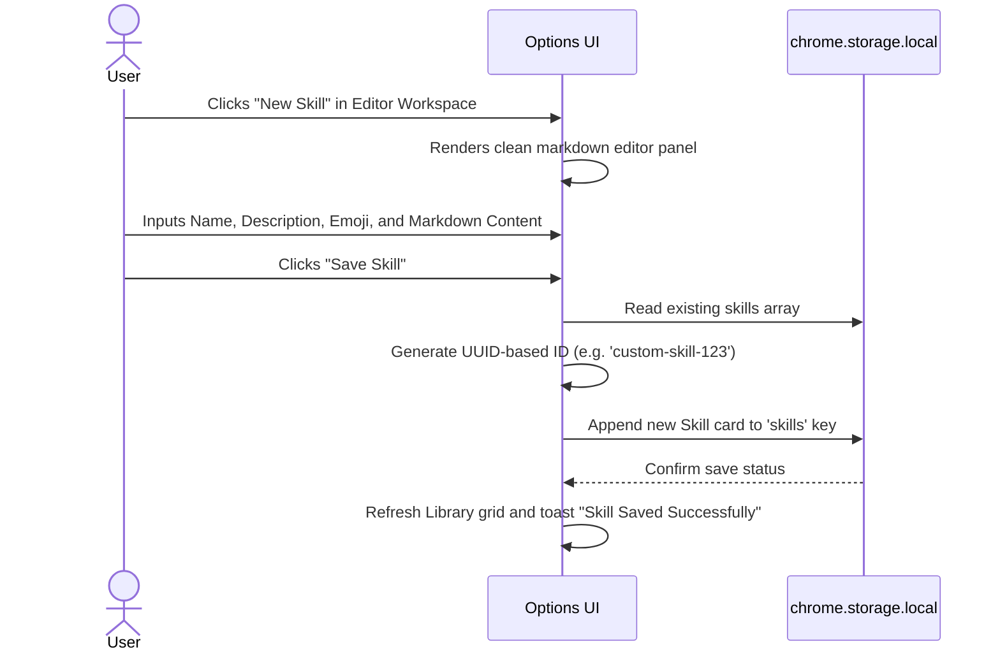
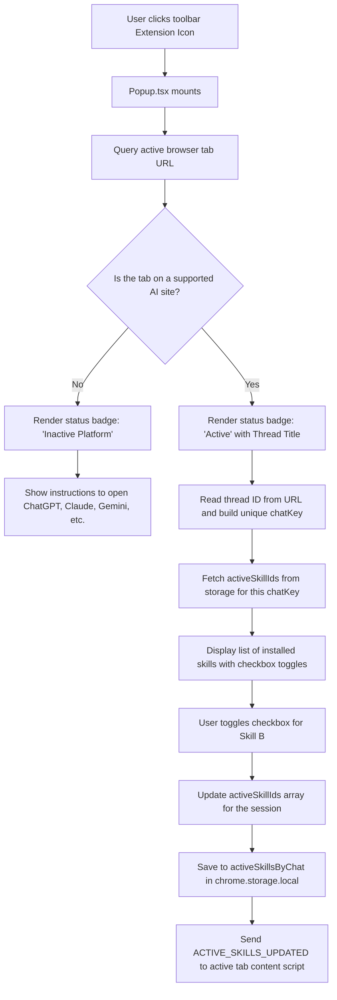
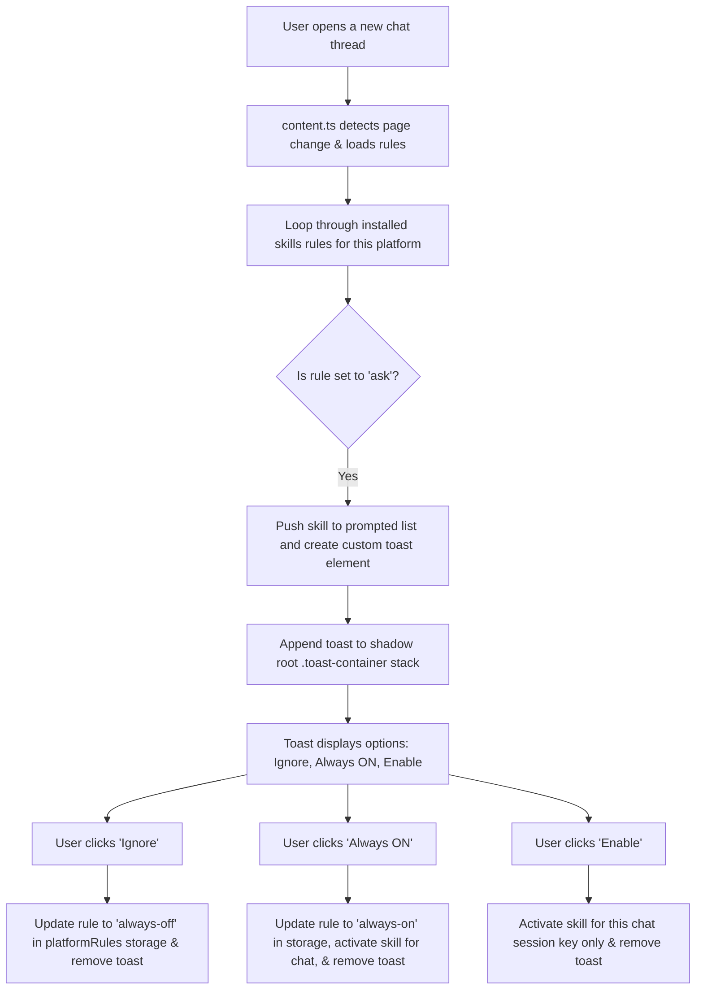
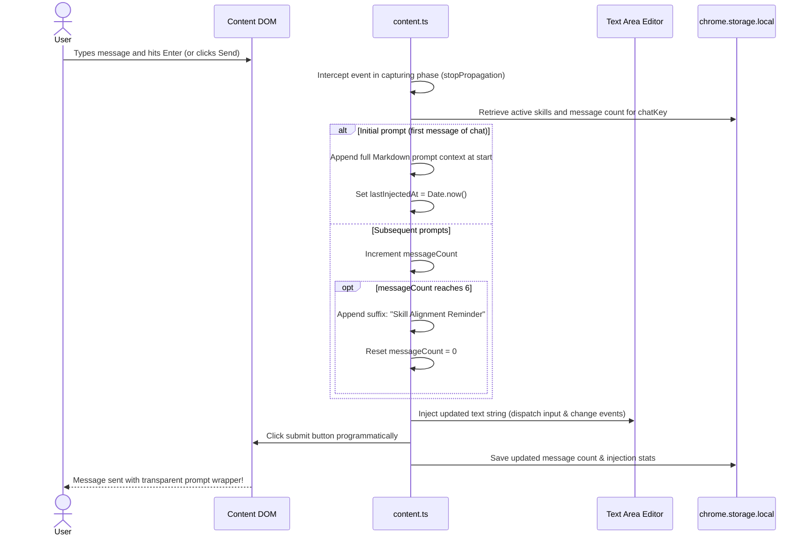

# Universal Skills — Application User Flows & Operations

This document maps out the operational and interactive pathways of the Universal Skills Chrome extension. It illustrates the sequence of steps, decision trees, and user-facing screens across the system.

---

## 1. Extension Initialization & First Run Flow

When the user first installs the extension, the background worker seeds the database to ensure a plug-and-play experience.



---

## 2. Option Console Management Flows (Full-Screen)

The options page (`chrome-extension://.../options/index.html`) is the central database management dashboard.

### 2.1 Skill Creation & Configuration Flow


### 2.2 Rules Matrix Configuration Flow
The Rules Matrix controls behavior profiles. Users can map any skill to auto-trigger on specific AI models.

```mermaid
graph TD
    A[User navigates to Options -> Rules Matrix] --> B[System loads installed skills & platform rules mapping]
    B --> C[Render grid matching Skills vs. Supported Platforms]
    C --> D[User clicks dropdown for Skill A on ChatGPT]
    D --> E[User chooses: Always On, Always Off, or Ask]
    E --> F[Update local platformRules dictionary: platformRules[skillId][platform] = Choice]
    F --> G[Save platformRules back to chrome.storage.local]
    G --> H[Sync update: Broadcast message ACTIVE_SKILLS_UPDATED to matching open tabs]
```

---

## 3. Popup Panel Control Flows (Browser Toolbar)

The browser Action Popup provides session-specific controls without leaving the active chat tab.



---

## 4. In-Chat Widget & Context Injection Flows (In-Page)

The content script operates directly inside the DOM of the AI platform, overlaying controls and intercepting user actions.

### 4.1 "Ask-to-Activate" Stacking Toast Flow
When navigating to a new conversation where no active skills are set up, the extension prompts the user:



### 4.2 Message Submission & Refresh Interception Flow
This flow intercepts message submissions to append rules, mitigating LLM memory loss/drift.


