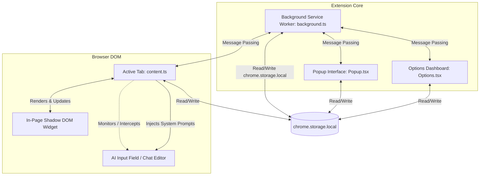
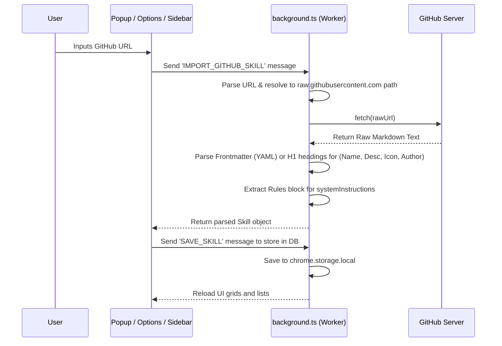

# Universal Skills — Extension Master Architecture Document

Universal Skills is a modern, high-performance Chrome Extension designed to inject portable, Claude-style system rules, custom prompts, and personality overlays (`.md` files) dynamically into popular AI platforms (ChatGPT, Claude, Gemini, DeepSeek, Grok, Perplexity, and Qwen) on the fly. 

This document serves as the master blueprint detailing the complete system architecture, operational components, user flows, data schemas, and integration points.

---

## 1. System Architecture Overview

The extension operates on a multi-tier, local-first model under Chrome Manifest V3. State is persisted in `chrome.storage.local` and synchronized reactively across four main contexts:



### Component Contexts:
1. **Background Service Worker (`background.ts`)**:
   - Acts as the main orchestrator and runs as a service worker.
   - Manages core data mutations (CRUD of skills, platform rules, active states).
   - Performs remote requests (such as fetching and parsing `.md` skill templates from GitHub).
   - Manages SPA (Single Page Application) navigation state syncing across tabs via key migration.

2. **Content Script (`content.ts`)**:
   - Injected into all matched AI hostnames.
   - Dynamically injects a **Floating Widget & Sidebar Dashboard** inside an isolated Shadow DOM wrapper (`#universal-skills-root`) to prevent host CSS contamination.
   - Monitors URL change pollers to detect SPA navigation and thread changes.
   - Intercepts chat submissions (Enter press or Send button clicks) to inject rules at the beginning of the text, and schedules periodic lightweight refresh reminders.

3. **Popup Page UI (`Popup.tsx`)**:
   - Serves as the quick-access panel in the browser toolbar.
   - Identifies whether the active tab is an AI chat session and loads the session context.
   - Allows users to toggle active skills, edit details, or upload/import new templates.

4. **Options Page UI (`Options.tsx`)**:
   - Serves as the full-screen central console.
   - Features a global **Rules Matrix** to bind skills to platforms permanently (Always On / Always Off / Ask).
   - Contains a community library loader, manual editor, and backup utilities (JSON Import/Export).

---

## 2. Technical Data Schemas

Universal Skills relies on standard storage namespaces inside `chrome.storage.local`.

### 2.1 Skill Object Structure
```typescript
interface Skill {
  id: string;                 // Kebab-case identifier (e.g., 'python-expert')
  name: string;               // Display title
  description: string;        // Brief usage summary
  version?: string;           // Semantic versioning (default: '1.0.0')
  author?: string;            // Creator's moniker
  content: string;            // Full markdown content containing the core instructions
  systemInstructions: string; // Lightweight refresh reminder/summary
  icon?: string;              // Graphical emoji (default: '🧠')
  githubUrl?: string;         // Remote repository link if synced
  createdAt: number;          // UNIX timestamp in milliseconds
}
```

### 2.2 Storage State Definitions
* **`skills`** (`Skill[]`): The database of all installed prompt modules.
* **`activeSkillsByChat`** (`Record<string, string[]>`):
  Maps a unique platform thread key to a list of enabled skill IDs.
  - *Key Format*: `${platform}_${conversationId}` (e.g. `chatgpt_9a4f-561b` or `claude_new`).
* **`platformRules`** (`Record<string, Record<string, 'always-on' | 'always-off' | 'ask'>>`):
  Maps `skillId` -> `platformId` -> Behavior preference. Controls whether the extension automatically enables a skill, remains inactive, or triggers a toast prompt when a thread starts.
* **`chatInjections`** (`Record<string, Record<string, { lastInjectedAt: number; messageCount: number; method: string }>>`):
  Tracks the injection state of active skills in the current chat. Counts message submissions to trigger refresh reminders every 6 messages.

---

## 3. Core Functional Workflows

### 3.1 GitHub Import & Parser Workflow


### 3.2 Submission Interception & Injection Flow
The content script intercepts user message submissions to feed the active skill's contents directly to the AI, ensuring alignment from the first prompt.

```mermaid
graph TD
    A[User types message & hits Enter or clicks Send] --> B{Active skills selected for chat?}
    B -- No --> C[Allow normal submission]
    B -- Yes --> D{Is this the first message in the chat?}
    
    D -- Yes --> E[Assemble Prefix: [Universal Skill Active: Name]\n Full MD rules \n ---\n]
    D -- No --> F[Increment messageCount]
    
    F --> G{Is messageCount >= 6?}
    G -- Yes --> H[Assemble Suffix: \n\n*Skill Alignment: Please maintain active rules...*]
    G -- No --> I[Assemble empty suffix]
    
    E --> J[Inject Prefix + User Text + Suffix into Editor]
    H --> J
    I --> J
    
    J --> K[Bypass React input binding state & dispatch events]
    K --> L[Programmatically trigger submit/click events]
    L --> M[Reset message count / update injection state in storage]
```

---

## 4. Platform Detection & DOM Selectors

Because AI interfaces dynamically modify their DOM tags, the content script utilizes target selectors to locate the text boxes and submission buttons:

| Platform | Hostname Match | Chat Input Selector | Submit Button Selector | Conversation ID Parse Pattern |
| :--- | :--- | :--- | :--- | :--- |
| **ChatGPT** | `chatgpt.com`, `openai.com` | `textarea#prompt-textarea` | `button[data-testid*="send" i]`, `button[type="submit"]` | `/c/([a-f0-9-]+)` |
| **Claude** | `claude.ai` | `div[contenteditable="true"][role="textbox"]` | `button[aria-label*="send" i]` | `/chat/([a-f0-9-]+)` |
| **Gemini** | `gemini.google.com` | `div[contenteditable="true"][role="textbox"]` | `button[aria-label*="send" i]` | `/app/([a-f0-9]+)` |
| **DeepSeek** | `deepseek.com` | `#chat-input`, `textarea` | `button[type="submit"]` | `/a/chat/s/([a-f0-9-]+)` |
| **Grok** | `grok.com`, `x.com/i/grok` | `textarea`, `div[contenteditable="true"]` | `button[aria-label*="send" i]` | `/chat/([a-f0-9-]+)` |
| **Perplexity**| `perplexity.ai` | `textarea[placeholder*="ask" i]`, `textarea` | `button[aria-label*="submit" i]` | `/search/([a-f0-9-]+)` |
| **Qwen** | `qwen.ai`, `qwenlm.ai` | `textarea` | `button` | `/chat/([a-f0-9-]+)` |

---

## 5. Development & Build Specifications

### 5.1 Project Directory Structure
```
universal-skills/
├── public/                 # Static extension assets
│   ├── manifest.json       # Chrome Manifest V3 descriptor
│   └── icons.svg           # Vector assets
├── src/
│   ├── background/         # Service worker scripts
│   │   └── background.ts
│   ├── content-scripts/    # Content injections & Shadow DOM widget
│   │   └── content.ts
│   ├── popup/              # Toolbar popup UI (React + Tailwind/CSS)
│   │   ├── Popup.tsx
│   │   ├── index.html
│   │   └── main.tsx
│   ├── options/            # Central options console (React)
│   │   ├── Options.tsx
│   │   ├── index.html
│   │   └── main.tsx
│   ├── App.tsx             # Root component (Vite structure)
│   └── index.css           # Global typography & color tokens
├── package.json            # Scripts & module dependencies
├── tsconfig.json           # TS rules references
└── vite.config.ts          # Rollup entry configurations for MV3 compiling
```

### 5.2 Build Commands
* Run Development Server: `npm run dev`
* Run Oxlint Verification: `npm run lint`
* Generate Production Build: `npm run build` (runs `tsc -b` for typechecking followed by `vite build`). Compiles the source files into absolute folder assets located inside `dist/`.
