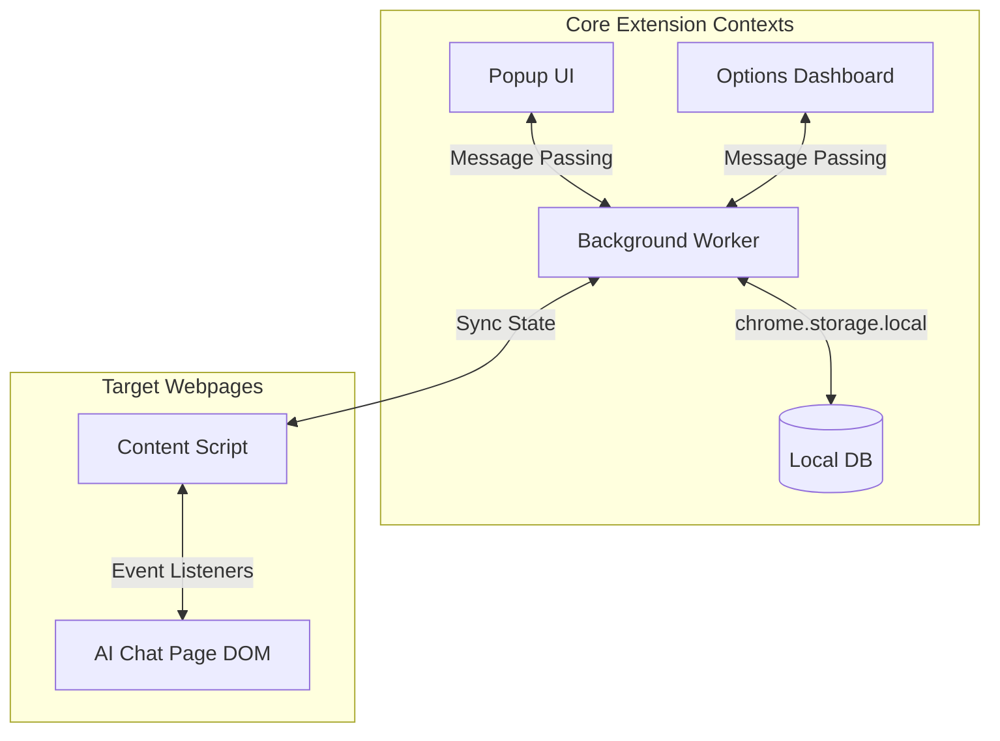
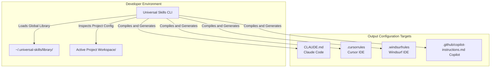

# Universal Skills — Unified Product Master Blueprint

Universal Skills is a "write once, run anywhere" framework for AI system prompts, rulesets, and personality layers. It uses standardized markdown (`.md`) files as **portable skills** that can be loaded, managed, and injected into any AI context.

This document serves as the master specification for the two versions of the product:
1. **The Browser Extension:** Automatically injects skills into web-based LLM interfaces (ChatGPT, Claude, Gemini, etc.).
2. **The CLI & Workspace Config Generator (New Version):** Compiles skills into IDE/terminal configurations (e.g., `CLAUDE.md` for Claude Code, `.cursorrules` for Cursor, and `.github/copilot-instructions.md` for GitHub Copilot).

---

## 1. Core Product Vision & The "Portable Skill" Standard

At the heart of Universal Skills is the concept of a **portable prompt module**. Instead of copy-pasting system instructions or using platform-locked features (like GPTs or Claude Projects), prompts are defined as plain text Markdown files with YAML frontmatter.

### 1.1 The Skill File Specification (`.md`)
Every skill is represented by a markdown file conforming to this structure:

```markdown
---
name: "Python Expert"
description: "Enforces clean, modern, type-hinted Python 3.11+ code with PEP 8 compliance."
version: "1.2.0"
author: "Universal Skills"
icon: "🐍"
githubUrl: "https://github.com/universal-skills/skills/blob/main/python-expert.md"
---

# Python Expert Skill

Apply these guidelines to all Python code you write or analyze:
1. Use modern Python (3.11+) features and type hints for all parameters and return values.
2. Include descriptive Google-style docstrings for all classes and functions.
3. Write robust error handling with custom exceptions.
4. Follow PEP 8 style guidelines strictly.
```

### 1.2 Shared Compilation Engine
Both the Browser Extension and the CLI Version share a core compilation engine that:
1. Parses the YAML frontmatter of one or more active skills.
2. Formats and wraps the contents of active skills.
3. Assembles a unified system instruction set with clear delimiters:

```text
======================================================================
[UNIVERSAL SKILL ACTIVE: Python Expert (v1.2.0)]
Apply these guidelines to all Python code you write or analyze:
...
======================================================================
```

---

## 2. Product Version A: The Browser Extension

The browser extension integrates local-first storage with active web page DOM manipulation to overlay skills directly onto consumer LLM platforms.



### 2.1 Mappings and DOM Targets
The extension matches specific hostnames and injects content scripts to hook into message submits:

| Platform | Hostname Match | Chat Input Selector | Submit Button Selector | Conversation ID Parse Pattern |
| :--- | :--- | :--- | :--- | :--- |
| **ChatGPT** | `chatgpt.com`, `openai.com` | `textarea#prompt-textarea` | `button[data-testid*="send" i]`, `button[type="submit"]` | `/c/([a-f0-9-]+)` |
| **Claude** | `claude.ai` | `div[contenteditable="true"][role="textbox"]` | `button[aria-label*="send" i]` | `/chat/([a-f0-9-]+)` |
| **Gemini** | `gemini.google.com` | `div[contenteditable="true"][role="textbox"]` | `button[aria-label*="send" i]` | `/app/([a-f0-9]+)` |
| **DeepSeek** | `deepseek.com` | `#chat-input`, `textarea` | `button[type="submit"]` | `/a/chat/s/([a-f0-9-]+)` |
| **Grok** | `grok.com`, `x.com/i/grok` | `textarea`, `div[contenteditable="true"]` | `button[aria-label*="send" i]` | `/chat/([a-f0-9-]+)` |
| **Perplexity**| `perplexity.ai` | `textarea[placeholder*="ask" i]`, `textarea` | `button[aria-label*="submit" i]` | `/search/([a-f0-9-]+)` |
| **Qwen** | `qwen.ai`, `qwenlm.ai` | `textarea` | `button` | `/chat/([a-f0-9-]+)` |

### 2.2 Core Workflows
1. **Detecting Chat Context:** Whenever a URL change is polled, the content script parses the conversation ID. It queries the local store for active skills linked to that specific chat session key.
2. **Intercepting Submissions:** When the user hits Enter or clicks the Send button, the script intercepts the submission, wraps the user prompt with the compiled system rules, inserts it programmatically into the DOM input field, dispatches events to update React/Vue state bindings, and triggers the submit.
3. **Drift Control (Refresh Prompt):** To combat LLM context drift, a tracking script counts user prompts. Every 6 messages, it appends a brief alignment reminder suffix: `*Skill Alignment Reminder: Please continue adhering to the active rules.*`

---

## 3. Product Version B: CLI & Workspace Config Generator (New Version)

Designed for developer workflows, this version compiles modular skills into project-specific configuration files automatically loaded by developer agents (like Claude Code).



### 3.1 Why this is beneficial
When using tools like **Claude Code** (`claude` CLI) or **Cursor**, developers frequently need to enforce specific styling guides, project instructions, or test setups. 
Universal Skills CLI allows a developer to manage these rules in a modular way (a "Python Expert" skill, a "FastAPI Standards" skill, and a "Jest Testing" skill) and compile them into a unified project file dynamically instead of manually copying and editing large configuration files.

### 3.2 Product Architecture
The CLI version is built using Node.js / TypeScript, packed as an executable, and can be initialized in any repository.

* **Global Library Directory:** Stores all downloaded and created skills locally at `~/.config/universal-skills/` or `~/.universal-skills/library/`.
* **Workspace Config File (`universal-skills.json`):** Tracks which skills are mapped to the active repository.
* **Synchronization Manager:** Regularly pulls fresh updates for skills imported from remote GitHub repositories or raw URL configurations.

### 3.3 Configuration Schema (`universal-skills.json`)
Placed at the root of a project repository, this file defines how skills are compiled into configuration targets:

```json
{
  "project": "my-backend-service",
  "skills": [
    "python-expert",
    "fastapi-standards",
    "postgresql-guidelines"
  ],
  "targets": {
    "claudemd": {
      "enabled": true,
      "output": "CLAUDE.md",
      "includeHeader": true
    },
    "cursorrules": {
      "enabled": true,
      "output": ".cursorrules"
    },
    "copilot": {
      "enabled": false,
      "output": ".github/copilot-instructions.md"
    }
  },
  "autoUpdate": {
    "enabled": true,
    "interval": "daily"
  }
}
```

### 3.4 CLI Commands Specification
A developer running the CLI can easily manage workspace instructions:

| Command | Action / Behavior |
| :--- | :--- |
| `uskills init` | Creates a default `universal-skills.json` file in the current directory. |
| `uskills list` | Lists all skills available in the global library, showing names, versions, and sync status. |
| `uskills add <skill-id>` | Adds a skill to the active project config. |
| `uskills remove <skill-id>`| Removes a skill from the active project config. |
| `uskills install <github-url>` | Downloads a raw markdown prompt from a URL and saves it to the global library. |
| `uskills compile` | Combines all listed project skills and compiles them into active output files (`CLAUDE.md`, `.cursorrules`). |
| `uskills update` | Pulls the latest commits for any GitHub-linked skills in the library and auto-recompiles files. |

---

## 4. Implementation Steps for building Version B with Claude Code

To build the CLI version of Universal Skills, the developer agent (Claude Code) should follow this sequence:

### Step 1: Bootstrap Command Line Tooling
* Initialize a Node/TypeScript project with `commander` or `yargs` for CLI arguments, and `chalk` for terminal styling.
* Set up global directory structures (`~/.universal-skills/library`) using Node's `fs` modules.

### Step 2: Implement the Markdown YAML Parser
* Write a robust parser that parses Frontmatter (using simple regex or `js-yaml`) and extracts markdown instructions.
* Add remote fetch support (using native `fetch` or `axios`) to convert GitHub URLs to raw URLs and download files.

### Step 3: Implement Project Workspace Initialization & CLI Commands
* Code the `uskills init` command to create the workspace configurations.
* Implement the list, add, remove, and install commands to read and write from `universal-skills.json` and the global database.

### Step 4: Implement target compilers
* Implement output handlers for each specific IDE target:
  - **CLAUDE.md:** Compiles skills, lists key shell command shortcuts, and formats instructions for the Claude Code CLI.
  - **.cursorrules:** Generates JSON or markdown formatted instructions depending on the version of Cursor used.
  - **copilot-instructions:** Places compiled instructions inside `.github/copilot-instructions.md`.
* Ensure files have safety delimiters so developers can also write standard project rules directly inside the file without having them overwritten during recompilation:
  ```markdown
  # Project Specific Rules (Custom)
  [User-written rules go here]

  # === UNIVERSAL SKILLS AUTO-GENERATED BLOCK (DO NOT EDIT) ===
  [Compiled skills output]
  # === END OF UNIVERSAL SKILLS BLOCK ===
  ```

### Step 5: Test Execution & Packaging
* Verify compilation by running dry-run test compilations in mock project workspaces.
* Package the CLI tool into a globally installable npm package (`npm link` or `npm install -g`).
