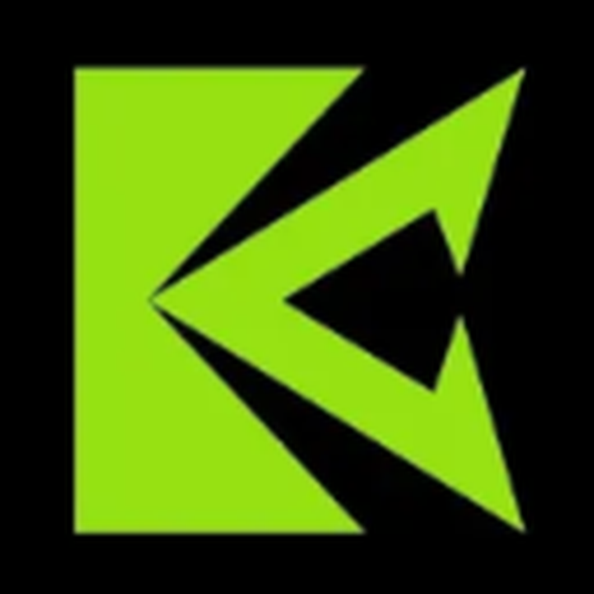

<p align="center">
  
</p>

# Universal Skills 🛠️

<p align="center">
  <a href="#installation">Chrome Extension</a>
</p>

<p align="center">
  
  
  
  
</p>

**The universal prompt alignment framework for AI chat interfaces.** It's the only extension with a zero-drift alignment loop — it injects custom instruction sets on conversation startup, counteracts context drift by auto-refreshing rules every 6 turns, and synchronizes your favorite profiles between browser extensions and local IDE configs (`CLAUDE.md`, `.cursorrules`). Inject prompts on ChatGPT, Claude, Gemini, DeepSeek, Grok, Perplexity, or Qwen with zero page style layout pollution.

Use any skill you want — Senior Python Architect, Creative Writer, UI Critic, or your own private GitHub templates. Toggle skills on the fly per chat session — no code changes, no prompt copy-pasting.

---

## The Problem

You start a fresh session with Claude or ChatGPT. You paste a 100-line markdown prompt detailing your architectural standards, security rules, and style preferences. For the first few prompts, the model complies. 

By message 10, the context window shifts, instructions drift, and the LLM reverts to generic responses, corporate clichés, and bloated code.

**Universal Skills solves this.** It mounts a Shadow-DOM widget directly over your chat input field, prepending your instructions on the initial submit and automatically injecting periodic alignment reminders every 6 messages to keep the LLM strictly pinned to your guidelines.

---

## Before / After

### Without Universal Skills (ChatGPT/Claude baseline)
* **Message 1:** You paste a rules prompt.
* **Message 2-4:** Works great.
* **Message 5:** The LLM hallucinates an external component, adds generic boilerplate, and forgets to add TypeScript definitions.
* **Message 10:** You copy-paste your instructions again, wasting tokens and reasoning context.

### With Universal Skills
* **Message 1:** You start typing. Universal Skills intercepts submission, injecting the selected **TypeScript Wizard** rules:
  ```markdown
  [Universal Skill Active: TypeScript Wizard]
  Follow these rules when constructing React components:
  1. Use exact prop interfaces. Never use 'any' or loose types...
  ---
  ```
* **Message 6:** The Zero-Drift Alignment Engine appends a small periodic reminder context:
  ```markdown
  *Reminder: Maintain all active instructions.*
  ```
* **Result:** Consistent, clean, and perfectly aligned code across 50+ message sessions without manual copy-pasting.

---

## Key Core Features

```
                   ┌────────────────────────────────────────┐
                   │        Your Markdown Skills (.md)       │
                   └───────────────────┬────────────────────┘
                                       │
                    Import via URL / GitHub / File Drag
                                       │
                                       ▼
                   ┌────────────────────────────────────────┐
                   │    Universal Skills Local Storage      │
                   └───────┬────────────────────────┬───────┘
                           │                        │
        Active Injection   │                        │ CLI Compiler (Version B)
                           ▼                        ▼
     ┌───────────────────────────┐     ┌───────────────────────────┐
     │ Chrome MV3 Content Script │     │ IDE Config File Sync      │
     │   (Shadow DOM Dashboard)  │     │ (CLAUDE.md / .cursorrules)│
     └───────────────────────────┘     └───────────────────────────┘
```

* 🚀 **Universal Platform Support:** Deep DOM selector hooks for **7 major AI platforms** (ChatGPT, Claude, Gemini, DeepSeek, Grok, Perplexity, Qwen).
* 🛡️ **Shadow DOM Isolation:** Renders options overlays, toggle indicators, and active badges completely inside isolated Shadow DOM nodes (`#universal-skills-root`) to guarantee zero page CSS conflicts.
* 📦 **GitHub Sync Pipeline:** Imports remote `.md` skills directly from raw GitHub URLs. Parses YAML frontmatter dynamically to extract `name`, `version`, `author`, `icon`, and `systemInstructions`.
* 🔄 **React & ProseMirror State Bypass:** Intercepts clicks and keyboard triggers, updating internal text inputs using high-compatibility event dispatchers and fallback text inserts.
* 🎚️ **Platform Activation Matrix:** Configures a custom rules matrix mapping each skill to a platform with options: `Always ON`, `Always OFF`, or `Ask to Activate` (toast notification prompts).
* 🛠️ **CLI Sync (Version B Roadmap):** Compiles the exact same markdown skills directly into your local IDE configs (`CLAUDE.md`, `.cursorrules`, `.github/copilot-instructions.md`) with delimiter protection wrappers.

---

## Platform Matrix Compatibility

Universal Skills monitors your window URL and binds to input elements using active DOM selectors:

| Platform | Text Input Selector | Chat ID RegEx | Status |
| :--- | :--- | :--- | :---: |
| **ChatGPT** | `#prompt-textarea` | `\/c\/([a-f0-9-]+)` | **Active** |
| **Claude** | `div[role="textbox"]` | `\/chat\/([a-f0-9-]+)` | **Active** |
| **Gemini** | `div[role="textbox"]` | `\/app\/([a-f0-9]+)` | **Active** |
| **DeepSeek** | `#chat-input` | `\/a\/chat\/s\/([a-f0-9-]+)` | **Active** |
| **Grok** | `textarea` | `\/chat\/([a-f0-9-]+)` | **Active** |
| **Perplexity** | `textarea[placeholder*="ask" i]` | `\/search\/([a-f0-9-]+)` | **Active** |
| **Qwen** | `textarea` | `\/chat\/([a-f0-9-]+)` | **Active** |

---

## Installation

### Product Version A: Chrome Extension (Local Installation)

Until Universal Skills is published in the Chrome Web Store, install it unpacked locally:

1. Clone this repository to your local machine:
   ```bash
   git clone https://github.com/your-username/universal-skills.git
   cd universal-skills
   ```
2. Install dependencies and compile the extension:
   ```bash
   npm install
   npm run build
   ```
3. Open Google Chrome and navigate to `chrome://extensions/`.
4. Toggle **Developer mode** in the top-right corner.
5. Click **Load unpacked** in the top-left and select the `dist` folder generated in your project root.

### Product Version B: CLI Utility (Roadmap)

To compile skills directly into IDE configuration rules files:

```bash
# Initialize universal skills workspace config
npx uskills init

# Fetch and install a skill locally
npx uskills install https://github.com/user/repo/blob/main/python-expert.md

# Compile active skills into CLAUDE.md, .cursorrules, etc.
npx uskills compile
```

---

## The Alignment Pipeline (How it works)

When you submit a message, Universal Skills runs the following checks before sending it to the LLM:

```
1. Is this a new conversation?
   ├─ YES ──► Inject full active skill content + frontmatter guidelines.
   └─ NO  ──► Skip full injection.

2. Does current message count match the refresh interval (default: 6)?
   ├─ YES ──► Append periodic alignment reminder suffix.
   └─ NO  ──► Submit original prompt untouched.
```

The system bypasses React and ProseMirror virtual DOM bindings using a simulated property injector:

```typescript
// Bypasses React and ProseMirror inputs safely
const nativeSetter = Object.getOwnPropertyDescriptor(window.HTMLTextAreaElement.prototype, "value")?.set;
nativeSetter.call(editorElement, newValue);
editorElement.dispatchEvent(new Event('input', { bubbles: true }));
```

---


---

## FAQ

**Q: Does this extension send my chats or prompts to any servers?**  
**A:** Never. Universal Skills is 100% local-first. All data, custom skills, matrix settings, and message counters are stored directly in your browser's private `chrome.storage.local`.

**Q: How do I backup my custom instructions?**  
**A:** Open the Options Console, click **Export**, and it will download a JSON backup of your entire library. You can restore this on any device using the **Import** utility.

**Q: Can I use multiple skills simultaneously?**  
**A:** Yes! You can toggle as many skills as you want for a single chat thread. The extension aggregates rules sequentially when prepending them.

---

## License

Universal Skills is open-source software licensed under the [MIT License](LICENSE).
